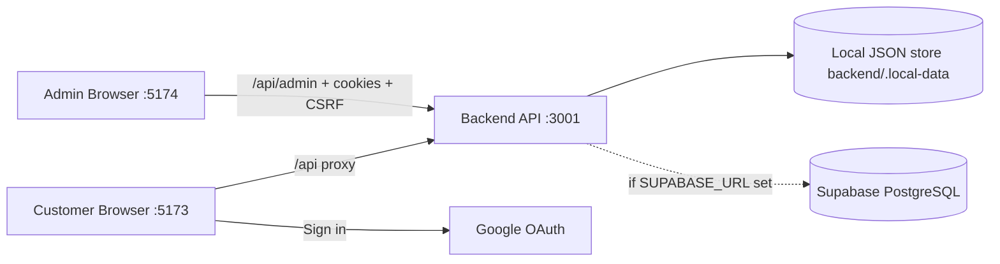

# RJ HUB Printing — Print HUB Customization Printing Services

IT-14 Final Project. A full-stack printing customization platform made of **three apps** that run together with one command:

| App | Folder | Port | Who uses it |
|---|---|---|---|
| Public Customer Website | `/` (root, `src/`) | http://localhost:5173 | Customers |
| Admin Panel | `admin/` | http://localhost:5174 | Shop owner / staff |
| Backend API (Express + TypeScript) | `backend/` | http://localhost:3001 | Both frontends |

---

## Folder Structure

```
Printing Customization Services/
├── src/                      # Public customer website (React + Vite + Tailwind)
│   ├── components/           # Navbar, chat widget, review slider, 3D customizer...
│   ├── context/              # AppStoreContext (session, inquiries, favorites)
│   ├── data/                 # Service catalog data
│   ├── pages/public/         # Home, Services, About, Blog, Contact, Login
│   ├── services/             # API repository + local fallback repository
│   ├── styles/               # Global CSS + animations
│   ├── types/                # Shared domain types
│   └── __tests__/            # Vitest tests
├── public/                   # Static images / service photos
├── admin/                    # Admin panel (separate React + Vite app)
│   └── src/
│       ├── pages/            # Dashboard, Messages, Clients, Logs, Settings
│       ├── components/       # Layout, sidebar, charts
│       ├── context/          # Admin auth session
│       └── lib/              # API client (CSRF-aware)
├── backend/                  # Express + TypeScript API
│   └── src/
│       ├── routes/           # public.ts (customers), adminOps.ts / admin auth
│       ├── db/               # store.ts (Local JSON store or Supabase), types.ts
│       ├── middleware/       # Admin session auth, security headers
│       ├── security/         # Argon2 hashing, CSRF, rate limiting, validation
│       ├── scripts/          # Admin provisioning scripts
│       └── __tests__/        # Security test suite (Vitest + Supertest)
├── supabase/migrations/      # PostgreSQL schema (optional production DB)
├── SETUP_GUIDE.md            # Production deployment guide (Supabase, Google OAuth)
└── package.json              # Root scripts (runs all 3 apps at once)
```

## Architecture



- Customers browse services, customize products, sign in with Google, send inquiries via chat, and leave reviews.
- Admin sees inquiries in **Message Management**, accepts them into **Client Records**, marks orders **Done/Cancelled** (moved to **Logs**), and views dashboard analytics.
- Backend uses a **local JSON file store** by default (no database needed). Set Supabase env vars to use PostgreSQL instead.

---

## Setup (Local Development)

### Requirements
- **Node.js 20+** and **npm**
- Git

### 1. Clone & install
```bash
git clone https://github.com/Marty-dev-arch/IT-14-Final-Project_Print-HUB-Customization-Printing-Services.git
cd IT-14-Final-Project_Print-HUB-Customization-Printing-Services

npm install
npm --prefix backend install
npm --prefix admin install
```

### 2. Environment files
Copy the example files (edit values if needed):
```bash
cp .env.example .env
cp backend/.env.example backend/.env
cp admin/.env.example admin/.env
```
> Windows PowerShell: use `Copy-Item .env.example .env` (same for the others).

For Google Sign-In, put your Google OAuth Client ID in `.env` (`VITE_GOOGLE_CLIENT_ID`) and `backend/.env` (`GOOGLE_CLIENT_ID`). See [SETUP_GUIDE.md](SETUP_GUIDE.md).

### 3. Run everything with one command
```bash
npm run dev
```
This starts **BACKEND (3001)**, **CUSTOMER (5173)** and **ADMIN (5174)** in a single terminal.

---

## Admin Server Guide

1. Open http://localhost:5174
2. Sign in with the **6-digit Security PIN** set for the owner account.
   - First run: provision the owner account using the script in `backend/src/scripts/` (see `backend/package.json` scripts), which sets the email, password and PIN.
3. Pages:
   - **Dashboard** — total inquiries, pending, completed, charts (auto-refresh every 5s).
   - **Message Management** — reply to customers, **Accept** (creates a Client Record) or **Decline** (moves to Message History). *Delete All* clears Message History.
   - **Client Records** — pending orders; edit item, quantity, price, reservation fee; set status to **Done** or **Cancelled**.
   - **Logs** — completed/cancelled orders; delete one or *Delete All*.
4. Destructive actions (delete) ask for your PIN again for security.

Run only the admin + backend:
```bash
npm run dev:backend
npm run dev:admin
```

## Public Customer Guide

1. Open http://localhost:5173
2. Browse **Services**, open a service to see prices, or use the **3D Customization Studio**.
3. Click **Sign In** → *Continue with Google* (remembers your last account; click it to pick another).
4. Use the **chat bubble** to send an inquiry — pick services (multiple services are joined with `&`), quantity, and attach photos. Use **+ Add another item** to add more services.
5. Replies from the shop appear in the same chat.
6. Leave feedback in **Customer Reviews** — your Google profile picture is shown on your review.

Run only the customer site + backend:
```bash
npm run dev:backend
npm run dev:customer
```

---

## Scripts

| Command | What it does |
|---|---|
| `npm run dev` | Run backend + customer + admin together |
| `npm run build` | Build customer site |
| `npm test` | Customer site tests |
| `npm --prefix backend test` | Backend security tests |
| `npm --prefix admin run build` | Build admin panel |

## Tech Stack
React 19 · Vite 6 · Tailwind CSS 4 · Three.js · Express · TypeScript · Argon2 · Vitest · Supabase (optional)
